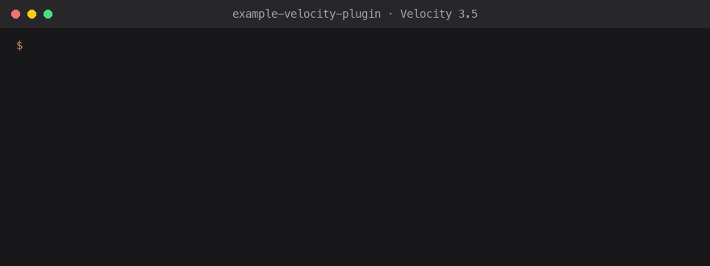

# Velocity plugin with SunLicense

<!-- sunlicense:distribution -->
[](https://github.com/sunlicense-com/example-velocity-plugin/actions/workflows/build.yml)
[](LICENSE)
[](https://docs.sunlicense.com/guide/templates)
[](https://sunlicense.com/start?ref=gh-velocity)

A working, copyable [Velocity](https://papermc.io/software/velocity) proxy plugin with
[SunLicense](https://sunlicense.com) built in: each proxy needs a valid license key, leaked keys can be
revoked or blocked, and your customers' networks keep running if SunLicense is ever unreachable.

- Gradle + Shadow, the official [Java SDK](https://github.com/sunlicense-com/sunlicense-java) relocated into your package
- License key from **config.properties**, or built in by **BuiltByBit / Voxel Shop** placeholders
- Clear console messages for every result (expired, revoked, too many proxies, blacklisted, …), keys masked
- Re-checked every few hours, so a revoke reaches running proxies (features switch off)
- **Offline fallback** with a signed license file (Ed25519, verified without network)
- Tests against a stub server, CI on GitHub Actions, and [AGENTS.md](AGENTS.md) for AI coding assistants

Runs on Velocity 3.5 (Java 21) and Velocity 4.x (Java 25); built against the 3.5 API with Java 21.
The same license code works in a BungeeCord or Waterfall plugin: only `MyPlugin.java` changes.

<p align="center"></p>

## Set up in one prompt

1. Click **Use this template** (or `gh repo create my-plugin --template sunlicense-com/example-velocity-plugin --private --clone`).
2. Open the folder in Claude Code, Cursor, Codex or Copilot and paste the prompt from
   **[sunlicense.com/prompt](https://sunlicense.com/prompt?ref=gh-velocity)**.

The agent installs the SunLicense CLI, creates a free guest account (no sign-up form; keep it by adding your email
later), a product, a policy and an API key, puts them where this template reads them ([AGENTS.md](AGENTS.md)) and
proves a license check comes back valid. Rather do it by hand? Make a
[free account](https://sunlicense.com/start?ref=gh-velocity) and follow the steps below.

## 1. Set up SunLicense

In the [dashboard](https://app.sunlicense.com):

1. **Products → New product** (your plugin), then a **policy**, e.g. "Network", *1 machine*: a machine is a proxy here.
2. **API keys → Create API key**. It can only validate licenses, so it's safe inside a jar.
3. Optional, for the offline fallback: open any license and copy **Public key**.

## 2. Make it yours

1. Use this template (or copy the folder), then rename `com.example.myplugin`, `MyPlugin`, the `@Plugin`
   id and `my-plugin` (`settings.gradle.kts`, the Java package).
2. Put the API key in your **user** Gradle properties (`~/.gradle/gradle.properties`), never in git:

   ```properties
   sunlicenseApiKey=slk_...
   sunlicensePublicKey=MCowBQYDK2VwAyEA...
   ```

   For a local SunLicense stack add `sunlicenseUrl=http://localhost`.
3. Build: `./gradlew build` → `build/libs/my-plugin-1.0.0.jar` (Java 21 needed; Gradle downloads itself).
4. Try it: `./gradlew runVelocity` starts a local Velocity proxy with the plugin (`end` stops it). Put a
   test license key in `run/plugins/myplugin/config.properties` and run `myplugin recheck` in its console.

Your features go in `core/CoreFeatures.java`, started by `MyPlugin.startFeatures()`, which runs once the license is valid, and are switched
off again in `stopFeatures()` if the license is revoked later (Velocity can't unload a plugin).

## 3. Sell it

| Where | How the key gets to the proxy |
|---|---|
| [BuiltByBit](https://docs.sunlicense.com/integrations/builtbybit), [Voxel Shop](https://docs.sunlicense.com/integrations/voxel-shop) | Create a `%%__SUNLICENSE__%%` placeholder in the store. It replaces `BUILT_IN_KEY` in `MyPlugin` with each buyer's key on download, so there's nothing to configure |
| [SpigotMC](https://docs.sunlicense.com/integrations/spigotmc), [Tebex](https://docs.sunlicense.com/integrations/tebex), [Gumroad](https://docs.sunlicense.com/integrations/gumroad) and the other stores | The buyer gets a key by email or on the redeem page and puts it in `config.properties` |

## What happens on a proxy

| SunLicense answers | The plugin |
|---|---|
| Valid | Starts your features; logs the masked key |
| Expired, revoked, suspended, unknown key, too many proxies, blacklisted | Logs why (see `license/Messages.java`) and keeps (or switches) your features off |
| Nothing (outage, network, rate limit) | Uses `plugins/myplugin/license.lic` if it's a valid offline license for this key; otherwise keeps running and retries every 10 minutes (`ALLOW_WHEN_UNREACHABLE = false` to stop instead) |

Each proxy keeps a random id in `plugins/myplugin/.server-id`, which is what counts against the policy's
machine limit. `/myplugin` shows the license status; `/myplugin recheck` re-reads the key and checks
again (permission `myplugin.admin`, and the console).

Developing against your own license? Add an **exclusion** for your machine or IP in SunLicense
([blacklists and exclusions](https://docs.sunlicense.com/guide/access-rules)) so your test proxies
don't use up slots.

**Usage statistics.** Every 30 minutes, in the background, the template tells SunLicense its version,
the Velocity and Java version, OS, architecture and CPU cores, so you see who runs what on the product's
**Analytics** tab (with the license and machine, like bStats). No player names, IP addresses or server
names. Buyers switch it off with `analytics=false` in `config.properties` or `SUNLICENSE_ANALYTICS=off`;
it never affects the license check. What is sent:
[docs](https://docs.sunlicense.com/guide/sdks#built-in-analytics).

## Protection

Release builds go further than a license check that an AI editor or a cracker could delete:

- **Sealed core.** Everything in the `core` package (`core/CoreFeatures.java`: your features) is encrypted in the
  release jar by `sunlicense seal`. Only a valid license check returns the key that opens it, so a copy whose check
  was cut out has nothing to run. The key from the last valid check is kept for 7 days, encrypted for this
  proxy (a `.sunlicense-unlock-…` file next to `plugins/myplugin/license.lic`), and an offline license file carries it too, so
  an outage doesn't stop your customers. A suspended, expired or revoked license gets no key.
- **Tamper reports.** The seal carries the SHA-256 of your other classes. A modified jar still starts, but says so
  in its next license check, and [Sentinel](https://docs.sunlicense.com/guide/sentinel) suggests suspending that license.
- **Ownership notice.** The header comment in `MyPlugin.java` and one start-up line
  (`MyPlugin is licensed software by You. License AX8P-XXXX-XXXX-XXXX. Terms: …`): set `AUTHOR` and `TERMS`.

Build a release with the [SunLicense CLI](https://docs.sunlicense.com/cli/) signed in (or `SUNLICENSE_TOKEN` set):

```bash
./gradlew build -PsunlicenseProduct=<your product code>
```

Ship `build/release/<jar>`. Without the property, `./gradlew build` is a development build with the core in
plain: test with it, don't sell it. In GitHub Actions, add the secret `SUNLICENSE_TOKEN` (a personal access
token) and the variable `SUNLICENSE_PRODUCT`, and the workflow builds the release jar. Code the platform loads by
name (the main class, the `@Plugin` class) stays outside `core`.

Honest limit: someone with a valid license can still pull the key out of memory and patch their copy; that copy
then reports itself as modified. [How protection works](https://docs.sunlicense.com/guide/protection).

## Files

```
build.gradle.kts                          Velocity API, SDK, Shadow relocation, settings baked into the jar
src/main/java/.../MyPlugin.java           start-up, re-checks, the command, your features
src/main/java/.../core/CoreFeatures.java    your features: the core, sealed in release builds
src/main/java/.../license/SealedCore.java  loads the core (sealed or plain) and checks the jar
src/main/java/.../license/SunLicenseProtection.java unlock, cache, integrity, notice (a copy of the SDK's; replace, don't edit)
src/main/java/.../license/LicenseGuard.java   online check → offline file → status (no Velocity, tested)
src/main/java/.../license/OfflineLicense.java Ed25519 offline license file check
src/main/java/.../license/Messages.java   what the proxy owner reads
src/main/java/.../license/SunLicenseAnalytics.java anonymous usage statistics (a copy of the SDK's; replace, don't edit)
src/main/resources/config.properties      license-key, recheck-hours, analytics
src/test/java/.../LicenseGuardTest.java   every result against a stub SunLicense
src/test/java/.../SealedCoreTest.java     the sealed core opens only with a valid unlock
.github/workflows/build.yml               CI
```

## Links

- Docs: [all templates](https://docs.sunlicense.com/guide/templates) · [SDKs](https://docs.sunlicense.com/guide/sdks) ·
  [store integrations](https://docs.sunlicense.com/integrations/)
- [SunLicense](https://sunlicense.com/?ref=gh-velocity): license keys for software you sell, with store integrations,
  a Discord bot for your buyers and leak alerts. Free for 3 products and 100 licenses:
  [create an account](https://sunlicense.com/start?ref=gh-velocity).
- Questions or a bug in this template: [open an issue](https://github.com/sunlicense-com/example-velocity-plugin/issues).

## Licence

[MIT No Attribution](LICENSE): copy any of it into your plugin, commercial or not, without credit.
